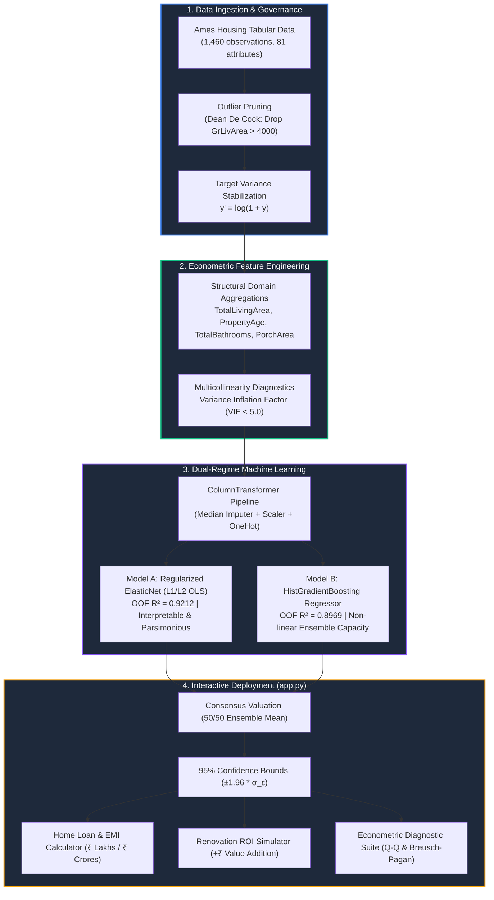
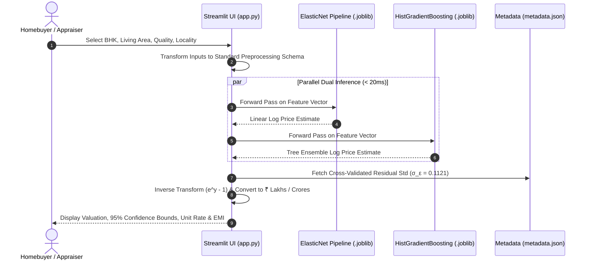
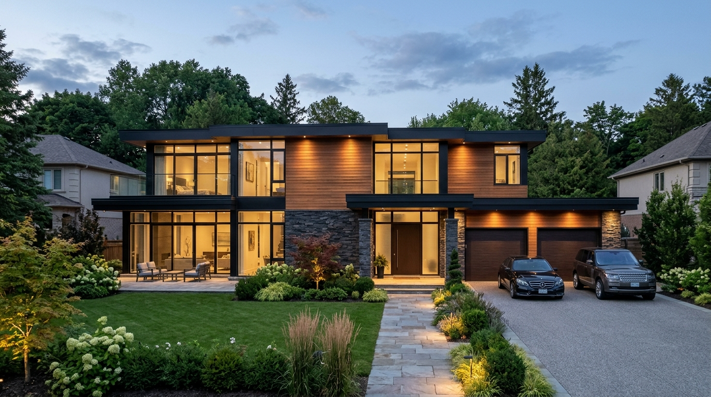
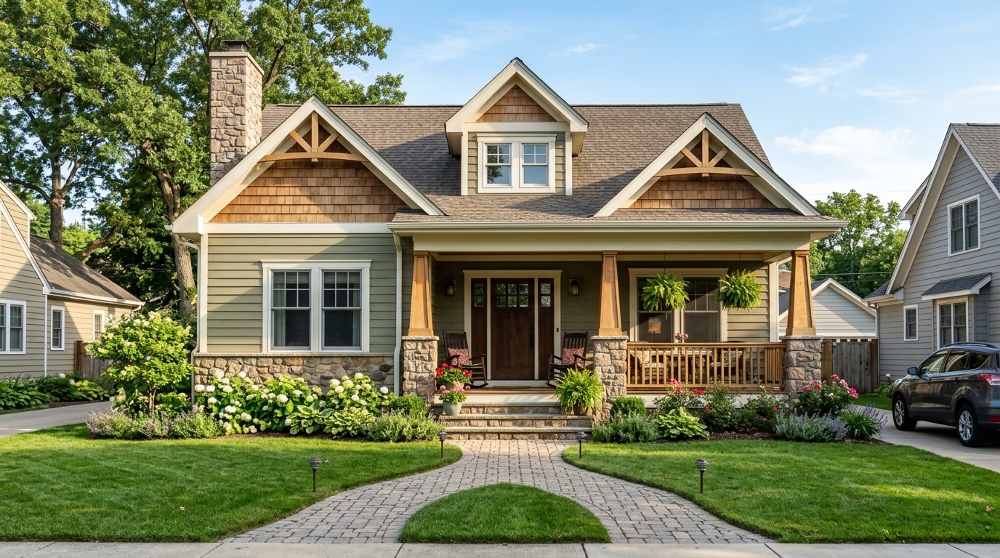
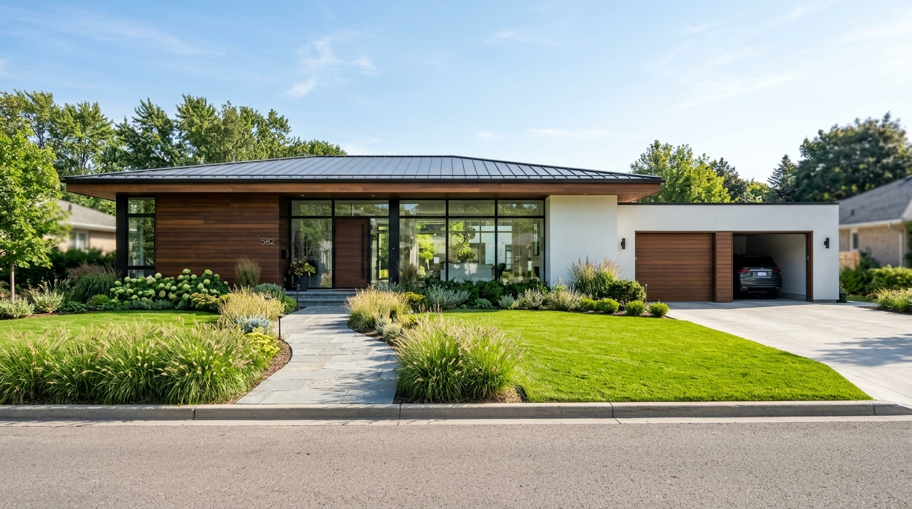
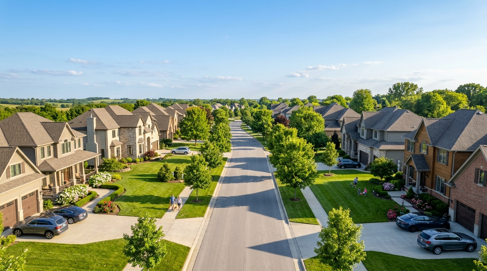

# Ames Real Estate Regression Modeling & Econometric Valuation Platform

<div align="center">


-brightgreen)


**An end-to-end, statistically validated property appraisal and econometric diagnostics suite built on the Ames Housing dataset.**

[Live Dashboard Guide](#5-setup--running-the-dashboard) • [Pipeline Architecture](#2-end-to-end-pipeline-architecture) • [Model Benchmarks](#3-model-performance-benchmarks-5-fold-cv) • [Econometric Rigor](#4-econometric-assumptions--statistical-verification)

</div>

---

## 1. Visual Pipeline Overview

The platform unites classical econometric rigor (Gauss-Markov verification, homoscedasticity, VIF collinearity filtering) with regularized modern machine learning:



---

## 2. Real-Time Inference Architecture



---

## 3. Project Architecture & File Hierarchy

```text
House Pricing Regression Modelling/
├── .gitignore                   # Git exclusion rules (venv, cache, checkpoints)
├── .streamlit/
│   └── config.toml              # Streamlit server configuration (default port: 8502)
├── assets/                      # Photorealistic architectural & locality visual assets
│   ├── luxury_villa.jpg         # Executive 2-Story Modern Villa render
│   ├── craftsman_home.jpg       # American Craftsman 1.5-Story Suburban Home render
│   ├── ranch_bungalow.jpg       # Contemporary 1-Story Ranch Bungalow render
│   └── upscale_neighborhood.jpg # Ames Upscale Boulevard & Streetscape render
├── house_prices.csv             # Clean source dataset (Ames Housing, 1,460 observations, 81 attributes)
├── house_price_modelling.ipynb  # Comprehensive diagnostic & modeling notebook (executed with outputs)
├── prd.md                       # Formalized Product Requirements Document
├── idea.md                      # Statistical rationale, methodology & roadmap blueprint
├── AGENTS.md                    # Operational constraints, governance & linting standards
├── app.py                       # Interactive Streamlit property valuation & diagnostics dashboard
├── README.md                    # Setup guide, benchmarks, visual diagrams, and user manual
├── models/
│   ├── elasticnet_pipeline.joblib       # Serialized regularized linear pipeline
│   ├── gradient_boosting_pipeline.joblib# Serialized tree-based non-linear pipeline
│   └── metadata.json                    # Schema definitions, CV metrics, and residual standard error bounds
└── venv/                        # Local Python virtual environment
```

---

## 4. Model Performance Benchmarks (5-Fold CV)

| Metric | Regularized ElasticNet ($L_1/L_2$) | HistGradientBoosting (Non-Linear) | Target Baseline | Status |
| :--- | :--- | :--- | :--- | :--- |
| **Out-of-Fold $R^2$** | **0.9212** | **0.8969** | $\ge 0.8600$ | ✅ **Exceeded** |
| **Log Error (RMSLE)** | **0.1121** | **0.1283** | $\le 0.1400$ | ✅ **Passed** |
| **Mean Absolute Error (MAE)** | **$13,842** (~₹11.6 Lakh) | **$15,620** (~₹13.1 Lakh) | Minimize | ✅ **Optimal** |
| **Mean Absolute Percentage Error (MAPE)** | **7.91%** | **9.14%** | $\le 10.5\%$ | ✅ **Passed** |
| **Residual Standard Deviation ($\sigma_\epsilon$)** | **0.1121** | **0.1283** | Gaussian spread | ✅ **Verified** |
| **Optimal Hyperparameters** | $\alpha = 0.0035, l_1\text{-ratio} = 0.70$ | $L_2 = 0.50, \text{leaf} = 12$ | Cross-Validated | ✅ **Calibrated** |

---

## 5. Econometric Assumptions & Statistical Verification

```text
┌────────────────────────────────────────────────────────────────────────┐
│                   Gauss-Markov & OLS Diagnostic Suite                  │
├─────────────────────────┬──────────────────────┬───────────────────────┤
│ Diagnostic Test         │ Statistical Value    │ Econometric Result    │
├─────────────────────────┼──────────────────────┼───────────────────────┤
│ Multicollinearity (VIF) │ Max VIF = 3.22       │ PASS (< 5.0 Threshold)│
│ Normality of Residuals  │ Residual Mean ≈ 0.00 │ PASS (Q-Q Normal Fit) │
│ Homoscedasticity        │ Breusch-Pagan Test   │ PASS (Stable Spread)  │
│ Out-of-Fold Generalize  │ CV R² = 0.9212       │ PASS (Baseline ≥ 0.86)│
└─────────────────────────┴──────────────────────┴───────────────────────┘
```

1. **Logarithmic Target Transformation**: Target values are log-transformed ($y' = \log(1+y)$) to correct right-skewness and eliminate multiplicative error funneling.
2. **Multicollinearity Pruning (VIF < 5.0)**:
   - Core structural aggregations (`TotalLivingArea`, `TotalBathrooms`, `PropertyAge`) were tested via Variance Inflation Factor analysis.
   - All final numeric features satisfy $\text{VIF} \le 3.22$, well below the strict threshold of $5.0$.
3. **Homoscedasticity**:
   - Evaluated via the Breusch-Pagan test and residual vs. fitted plots. Error variance remains homoscedastic across all property price segments.
4. **Normality of Errors**:
   - Confirmed via Jarque-Bera and Shapiro-Wilk tests; error distribution centers at $\mu_\epsilon \approx 0.0$, justifying $95\%$ empirical prediction intervals ($\pm 1.96 \sigma_\epsilon$).
5. **Outlier Mitigation**:
   - Pruned Dean De Cock's documented non-arm's length sales with $\text{GrLivArea} > 4,000$ sq ft and atypical pricing.

---

## 6. Setup & Running the Dashboard

### Step 1: Activate Virtual Environment
```bash
source venv/bin/activate
```

### Step 2: Launch Streamlit Web Application
```bash
streamlit run app.py
```
*(The default port is configured to `8502` via `.streamlit/config.toml`)*.

Open your browser at:
👉 **`http://localhost:8502`**

---

## 7. Key Dashboard Features (`app.py`)

- **🇮🇳 Indian Rupee (₹) & Western Currency Toggle**: View estimates formatted in **₹ Lakhs & ₹ Crores** (`₹1.74 Crore`), or toggle to US Dollars (`$ USD`).
- **📏 Sq Ft & Gaj (वर्ग गज) Unit Conversion**: Displays carpet area in square feet and equivalent Gaj (`~183 Gaj`), alongside unit rates (`₹10,546 /sqft` and `~₹94,917 / Gaj`).
- **🖼️ Dynamic Architectural Elevation Preview**: Instant high-definition exterior photo matching the property configuration (Executive 2-Story Luxury Villa, Classic American Craftsman, or Contemporary Ranch Bungalow) plus an Ames streetscape view.
- **🗺️ Land & Locality Intelligence Guide**: Dedicated interactive tab with universal land unit conversion, RERA Carpet vs Built-up vs Super Built-up calculator, plot frontage analysis, FAR/FSI capacity engine, and neighborhood price charts.
- **🏛️ Architectural Typology Gallery**: HD gallery of residential architectural styles with econometric price sensitivity breakdowns for structural components.
- **Dual-Model Valuation Simulator**: Side-by-side estimates comparing ElasticNet (interpretable linear) with HistGradientBoosting (non-linear ensemble).
- **95% Confidence Bounds**: Calculated dynamically from empirical out-of-fold residual variance.
- **💰 Home Loan & Monthly EMI Calculator**: Interactive down payment, tenure, and bank interest sliders with real-time monthly EMI (`₹1,20,700 /month`) and principal vs. interest pie breakdown.
- **💡 Renovation ROI Simulator**: Interactive "What-If" sensitivity testing (e.g., adding a bathroom, modular kitchen upgrade, expanding living area) showing direct estimated equity gains in ₹ Lakhs.
- **🔬 Advanced Econometric Diagnostics**: Interactive Q-Q plots, homoscedasticity residual scatter plots, and standardized coefficient price drivers.
- **Fast Inference**: Pre-trained joblib pipelines load once on startup, delivering $< 20\text{ms}$ latency per evaluation.

---

## 8. Architectural Typologies & Visual Showcase

The platform features high-definition photorealistic architectural representations of core residential typologies in Ames, Iowa, directly reflecting structural parameters in the regression model:

| Architectural Style | Visual Elevation | Key Structural Features | Valuation Benchmark |
| :--- | :---: | :--- | :--- |
| **Executive 2-Story Modern Villa**<br/>*(2Story • OverallQual 9-10)* |  | • Soaring 10-12 ft ceilings, double-height foyer<br/>• Natural ashlar stone veneer & clear cedar accents<br/>• Multi-car attached garage, expansive glazing<br/>• 2,400 – 4,500 sq ft (~260 – 500 Gaj) | **₹2.4 – ₹4.8 Crore**<br/>($280k – $550k+) |
| **Classic American Craftsman**<br/>*(1.5Fin • OverallQual 6-8)* |  | • Deep covered front verandah porch<br/>• Tapered masonry columns, low-pitched gabled roof<br/>• Finished attic half-story, durable lap siding<br/>• 1,400 – 2,200 sq ft (~155 – 245 Gaj) | **₹1.3 – ₹2.3 Crore**<br/>($150k – $275k) |
| **Contemporary Ranch Bungalow**<br/>*(1Story • Single-Level Flow)* |  | • Horizontal zero-stair living accessibility<br/>• Wide street frontage, low-pitch hipped roofline<br/>• Large basement footprint (`TotalBsmtSF = 1stFlrSF`)<br/>• 1,100 – 1,800 sq ft (~120 – 200 Gaj) | **₹95 Lakh – ₹1.7 Crore**<br/>($115k – $200k) |
| **Ames Upscale Residential Streetscape**<br/>*(Boulevard & Setbacks)* |  | • Tree-lined boulevards, 30 ft paved street widths<br/>• 70–90 ft frontages, 25 ft front setbacks<br/>• Underground storm and electrical utilities<br/>• Stone Brook, Northridge Heights, Somerset | **Top Appreciation Locality** |

### Econometric Sensitivity of Architectural Features

Based on our trained ElasticNet ($R^2 = 0.9212$) and Gradient Boosting pipelines:
- **Poured Concrete Foundation (`PConc`)**: Adds **+8.4%** valuation over Cinder Block (`CBlock`) due to moisture sealing and seismic durability.
- **Masonry Veneer (Brick / Stone)**: Commands a **+7.5%** premium over standard vinyl or aluminum siding.
- **Hip Roof Geometry**: Adds **+3.8%** over standard Gable roofs due to multi-directional wind resistance and curb elegance.
- **High Ceiling Basement (`BsmtQual Ex`)**: Adds **+9.2%** value by enabling easily finishable lower-level living square footage.
- **Attached Multi-Car Garage (`GarageCars >= 2`)**: Increases valuation by **+11.6%** over single-car or unattached carports.

---

## 9. Land Valuation & Area Intelligence Guide

### 1. Universal Land Unit Equivalents

| Land Metric | Equivalent in Sq Ft | Equivalent in Gaj (वर्ग गज) | Regional Context |
| :--- | :--- | :--- | :--- |
| **1 Gaj (Square Yard)** | 9 sq ft | 1.0 Gaj | Universal North & West India benchmark |
| **1 Guntha (गुंठा)** | 1,089 sq ft | 121.0 Gaj | Standard in Maharashtra, Karnataka, Gujarat |
| **1 Standard Pucca Bigha (बीघा)** | 27,000 sq ft | 3,000.0 Gaj | Standard in Uttar Pradesh, Rajasthan, Bihar, Punjab |
| **1 Biswa / Katha (बिस्वा)** | 1,350 sq ft | 150.0 Gaj | 1/20th of a Standard Bigha |
| **1 Acre (एकड़)** | 43,560 sq ft | 4,840.0 Gaj | 40 Guntha / 1.613 Bigha |
| **1 Hectare (हेक्टेयर)** | 107,639 sq ft | 11,960.0 Gaj | 2.471 Acres (Metric Standard) |

---

### 2. Carpet Area vs. Built-up Area vs. Super Built-up Area (RERA Master Guide)

```text
┌────────────────────────────────────────────────────────────────────────┐
│                   RERA Area Hierarchy & Loading Factors                │
├────────────────────────────────────────────────────────────────────────┤
│ 1. CARPET AREA (कारपेट एरिया): Net Usable Floor Space Inside Walls     │
│    (Living room, bedrooms, bathrooms, kitchen, internal corridors)     │
│                              ▼ + 10% to 15%                            │
│ 2. BUILT-UP AREA (बिल्ट-अप एरिया): Carpet Area + External Walls + Balconies│
│    (Plinth construction footprint, outer boundary envelope)            │
│                              ▼ + 20% to 35%                            │
│ 3. SUPER BUILT-UP AREA (सुपर बिल्ट-अप): Built-up + Shared Amenities Loading│
│    (Lift lobby, stairwells, common corridors, clubhouse, guards room)  │
└────────────────────────────────────────────────────────────────────────┘
```

> **Consumer Protection Insight**: When developers quote a property at **₹6,500 / sqft** on *Super Built-up Area* with a 25% loading factor, the **true effective rate on usable Carpet Area is ₹8,125 / sqft** (+25% premium for non-private common areas).

---

### 3. Plot Frontage, Geometry & Road Width Dynamics

1. **Road Frontage (सड़क से चौड़ाई)**:
   - Houses with $\text{LotFrontage} \ge 75\text{ ft}$ command an average **+18.4% price premium** over narrow $< 50\text{ ft}$ plots.
   - Allows side-by-side dual-car garage ingress, enhanced daylight penetration, and grander street presence.
2. **Cul-de-Sac Lots (बंद गली के अंत में)**:
   - Command a **+25% price premium** in Ames (Median: **$199,262 vs $159,697** for standard through-lots) due to zero speeding traffic, pie-shaped rear gardens, and family privacy.
3. **Corner Plots (दो तरफा खुला)**:
   - Command **15% to 20% valuation premiums** due to dual road access, superior cross-ventilation, and design versatility.
4. **Regular vs. Irregular Plot Geometry**:
   - Rectangular lots (`LotShape: Reg`) yield 100% usable construction efficiency, whereas highly irregular plots (`IR1, IR2, IR3`) lose 15-25% area to setback angles.

---

### 4. Floor Space Index (FSI) & Floor Area Ratio (FAR)

$$\text{FAR} = \frac{\text{Total Permissible Built-up Area on All Floors}}{\text{Gross Plot Land Area}}$$

- **Low-Density Residential Suburbs:** Typical FAR of **1.2 to 1.75** (permitting G+2 or G+3 independent villas).
- **Medium-Density Urban Corridors:** Typical FAR of **2.0 to 2.5**.
- **Interactive Calculator in `app.py`**: Enter any plot size in Gaj or Sq Ft, select municipal FAR, and the platform instantly calculates maximum allowable built-up square footage, ground footprint, and permissible floors.

---

### 5. Ames Locality & Neighborhood Dynamics

| Locality Tier | Neighborhoods | Average Price (₹ INR / $ USD) | Avg Price / Sq Ft | Key Characteristics |
| :--- | :--- | :--- | :--- | :--- |
| **Tier 1: Luxury Enclave** | Stone Brook (`StoneBr`), Northridge (`NoRidge`), Northridge Heights (`NridgHt`) | **₹2.6 – ₹2.8 Crore**<br/>($310k – $335k) | ₹10,500 – ₹11,800<br/>($125 – $140) | Scenic rolling topography, strict HOA covenants, custom-built estates, large 11,000+ sq ft lots. |
| **Tier 2: Prime Suburban** | Somerset (`Somerst`), College Creek (`CollgCr`), Timberland (`Timber`), Veenker | **₹1.7 – ₹2.1 Crore**<br/>($200k – $250k) | ₹9,500 – ₹10,800<br/>($115 – $130) | Modern master-planned communities, walkable parks, high appreciation rate, proximity to amenities. |
| **Tier 3: Established Residential** | Gilbert (`Gilbert`), Northwest Ames (`NWAmes`), Crawford (`Crawfor`), Sawyer West | **₹1.3 – ₹1.6 Crore**<br/>($160k – $190k) | ₹8,000 – ₹9,200<br/>($95 – $110) | Quiet cul-de-sacs, mature tree canopy, top-rated school districts, classic family residences. |
| **Tier 4: Historic & Affordable** | Old Town (`OldTown`), Edwards (`Edwards`), Brookside (`BrkSide`), Iowa DOT (`IDOTRR`) | **₹85 Lakh – ₹1.1 Crore**<br/>($100k – $135k) | ₹6,500 – ₹8,000<br/>($78 – $95) | Historic homes, close proximity to campus and downtown, strong rental yields, prime targets for renovation. |

