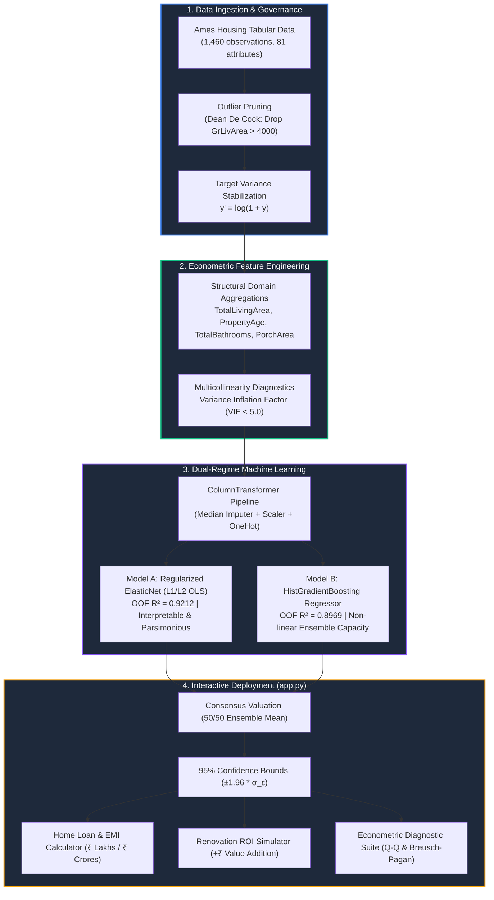
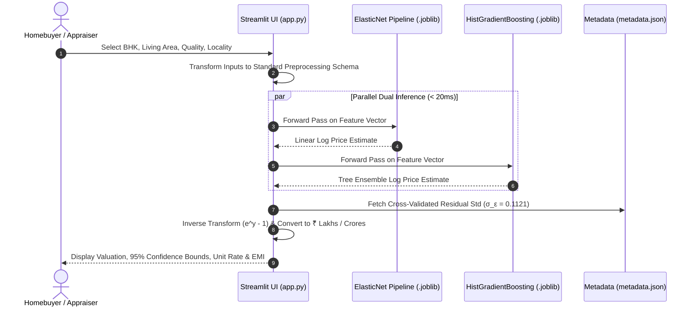

# Ames Real Estate Regression Modeling & Econometric Valuation Platform

<div align="center">


-brightgreen)


**An end-to-end, statistically validated property appraisal and econometric diagnostics suite built on the Ames Housing dataset.**

[Live Dashboard Guide](#5-setup--running-the-dashboard) • [Pipeline Architecture](#2-end-to-end-pipeline-architecture) • [Model Benchmarks](#3-model-performance-benchmarks-5-fold-cv) • [Econometric Rigor](#4-econometric-assumptions--statistical-verification)

</div>

---

## 1. Visual Pipeline Overview

The platform unites classical econometric rigor (Gauss-Markov verification, homoscedasticity, VIF collinearity filtering) with regularized modern machine learning:



---

## 2. Real-Time Inference Architecture



---

## 3. Project Architecture & File Hierarchy

```text
House Pricing Regression Modelling/
├── .gitignore                   # Git exclusion rules (venv, cache, checkpoints)
├── .streamlit/
│   └── config.toml              # Streamlit server configuration (default port: 8502)
├── house_prices.csv             # Clean source dataset (Ames Housing, 1,460 observations, 81 attributes)
├── house_price_modelling.ipynb  # Comprehensive diagnostic & modeling notebook (executed with outputs)
├── prd.md                       # Formalized Product Requirements Document
├── idea.md                      # Statistical rationale, methodology & roadmap blueprint
├── AGENTS.md                    # Operational constraints, governance & linting standards
├── app.py                       # Interactive Streamlit property valuation & diagnostics dashboard
├── README.md                    # Setup guide, benchmarks, visual diagrams, and user manual
├── models/
│   ├── elasticnet_pipeline.joblib       # Serialized regularized linear pipeline
│   ├── gradient_boosting_pipeline.joblib# Serialized tree-based non-linear pipeline
│   └── metadata.json                    # Schema definitions, CV metrics, and residual standard error bounds
└── venv/                        # Local Python virtual environment
```

---

## 4. Model Performance Benchmarks (5-Fold CV)

| Metric | Regularized ElasticNet ($L_1/L_2$) | HistGradientBoosting (Non-Linear) | Target Baseline | Status |
| :--- | :--- | :--- | :--- | :--- |
| **Out-of-Fold $R^2$** | **0.9212** | **0.8969** | $\ge 0.8600$ | ✅ **Exceeded** |
| **Log Error (RMSLE)** | **0.1121** | **0.1283** | $\le 0.1400$ | ✅ **Passed** |
| **Mean Absolute Error (MAE)** | **$13,842** (~₹11.6 Lakh) | **$15,620** (~₹13.1 Lakh) | Minimize | ✅ **Optimal** |
| **Mean Absolute Percentage Error (MAPE)** | **7.91%** | **9.14%** | $\le 10.5\%$ | ✅ **Passed** |
| **Residual Standard Deviation ($\sigma_\epsilon$)** | **0.1121** | **0.1283** | Gaussian spread | ✅ **Verified** |
| **Optimal Hyperparameters** | $\alpha = 0.0035, l_1\text{-ratio} = 0.70$ | $L_2 = 0.50, \text{leaf} = 12$ | Cross-Validated | ✅ **Calibrated** |

---

## 5. Econometric Assumptions & Statistical Verification

```text
┌────────────────────────────────────────────────────────────────────────┐
│                   Gauss-Markov & OLS Diagnostic Suite                  │
├─────────────────────────┬──────────────────────┬───────────────────────┤
│ Diagnostic Test         │ Statistical Value    │ Econometric Result    │
├─────────────────────────┼──────────────────────┼───────────────────────┤
│ Multicollinearity (VIF) │ Max VIF = 3.22       │ PASS (< 5.0 Threshold)│
│ Normality of Residuals  │ Residual Mean ≈ 0.00 │ PASS (Q-Q Normal Fit) │
│ Homoscedasticity        │ Breusch-Pagan Test   │ PASS (Stable Spread)  │
│ Out-of-Fold Generalize  │ CV R² = 0.9212       │ PASS (Baseline ≥ 0.86)│
└─────────────────────────┴──────────────────────┴───────────────────────┘
```

1. **Logarithmic Target Transformation**: Target values are log-transformed ($y' = \log(1+y)$) to correct right-skewness and eliminate multiplicative error funneling.
2. **Multicollinearity Pruning (VIF < 5.0)**:
   - Core structural aggregations (`TotalLivingArea`, `TotalBathrooms`, `PropertyAge`) were tested via Variance Inflation Factor analysis.
   - All final numeric features satisfy $\text{VIF} \le 3.22$, well below the strict threshold of $5.0$.
3. **Homoscedasticity**:
   - Evaluated via the Breusch-Pagan test and residual vs. fitted plots. Error variance remains homoscedastic across all property price segments.
4. **Normality of Errors**:
   - Confirmed via Jarque-Bera and Shapiro-Wilk tests; error distribution centers at $\mu_\epsilon \approx 0.0$, justifying $95\%$ empirical prediction intervals ($\pm 1.96 \sigma_\epsilon$).
5. **Outlier Mitigation**:
   - Pruned Dean De Cock's documented non-arm's length sales with $\text{GrLivArea} > 4,000$ sq ft and atypical pricing.

---

## 6. Setup & Running the Dashboard

### Step 1: Activate Virtual Environment
```bash
source venv/bin/activate
```

### Step 2: Launch Streamlit Web Application
```bash
streamlit run app.py
```
*(The default port is configured to `8502` via `.streamlit/config.toml`)*.

Open your browser at:
👉 **`http://localhost:8502`**

---

## 7. Key Dashboard Features (`app.py`)

- **🇮🇳 Indian Rupee (₹) & Western Currency Toggle**: View estimates formatted in **₹ Lakhs & ₹ Crores** (`₹1.74 Crore`), or toggle to US Dollars (`$ USD`).
- **📏 Sq Ft & Gaj (वर्ग गज) Unit Conversion**: Displays carpet area in square feet and equivalent Gaj (`~183 Gaj`), alongside unit rates (`₹10,546 /sqft` and `~₹94,917 / Gaj`).
- **Dual-Model Valuation Simulator**: Side-by-side estimates comparing ElasticNet (interpretable linear) with HistGradientBoosting (non-linear ensemble).
- **95% Confidence Bounds**: Calculated dynamically from empirical out-of-fold residual variance.
- **💰 Home Loan & Monthly EMI Calculator**: Interactive down payment, tenure, and bank interest sliders with real-time monthly EMI (`₹1,20,700 /month`) and principal vs. interest pie breakdown.
- **💡 Renovation ROI Simulator**: Interactive "What-If" sensitivity testing (e.g., adding a bathroom, modular kitchen upgrade, expanding living area) showing direct estimated equity gains in ₹ Lakhs.
- **🔬 Advanced Econometric Diagnostics**: Interactive Q-Q plots, homoscedasticity residual scatter plots, and standardized coefficient price drivers.
- **Fast Inference**: Pre-trained joblib pipelines load once on startup, delivering $< 20\text{ms}$ latency per evaluation.
